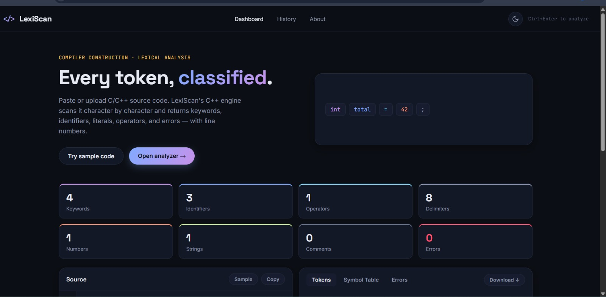
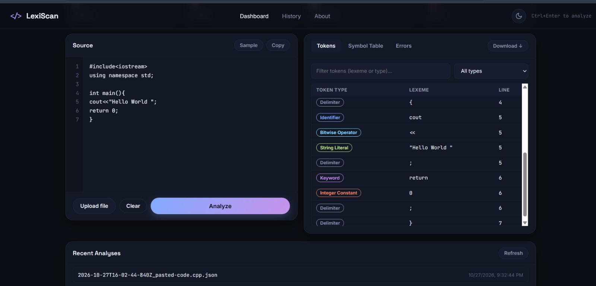

# LexicalAnalyser 🔍

## Compiler Construction Project

LexicalAnalyser is a compiler construction project that performs lexical analysis on source code. It identifies and classifies tokens such as keywords, identifiers, operators, and numeric constants, which are essential components of the compilation process.

## Features

- Performs lexical analysis of source code.
- Identifies and classifies different tokens.
- Recognizes keywords, identifiers, operators, and constants.
- Displays token analysis results.
- Provides a simple web-based interface.

## Technologies Used

- **C++** — Lexical analysis and token processing
- **HTML** — Web page structure
- **CSS** — Styling and layout
- **JavaScript** — Frontend functionality
- **Node.js** — Project execution environment

## Screenshots

### Homepage


### Output


## Project Structure

```text
LexicalAnalyser/
├── Lexer.cpp
├── Lexer.h
├── Token.cpp
├── Token.h
├── analyzer.cpp
├── build.js
├── index.html
├── package.json
├── script.js
├── server.js
├── start.js
├── style.css
├── screenshots/
│   ├── HomePage.jpeg
│   └── Output.jpeg
└── README.md
```

## Installation and Setup

### Prerequisites

- [Node.js](https://nodejs.org/)
- A web browser

### Steps

1. Clone the repository:

   ```bash
   git clone https://github.com/sejalbhupal/LexicalAnalyser.git
   ```

2. Navigate to the project directory:

   ```bash
   cd LexicalAnalyser
   ```

3. Install dependencies:

   ```bash
   npm install
   ```

4. Start the project:

   ```bash
   npm start
   ```

5. Open the local URL displayed in the terminal.

## Learning Outcomes

- Understanding the role of lexical analysis in compiler construction.
- Learning how tokens are identified and classified.
- Applying C++ programming concepts to compiler design.
- Integrating frontend technologies with project functionality.

## Author

**Sejal Ravindra Bhupal**

GitHub: [sejalbhupal](https://github.com/sejalbhupal)

---

*Developed as part of a Compiler Construction project.*
